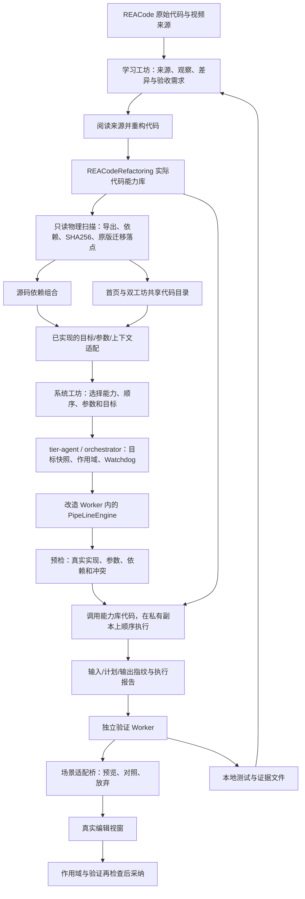
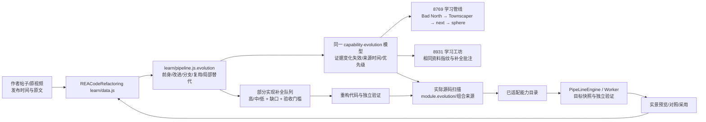
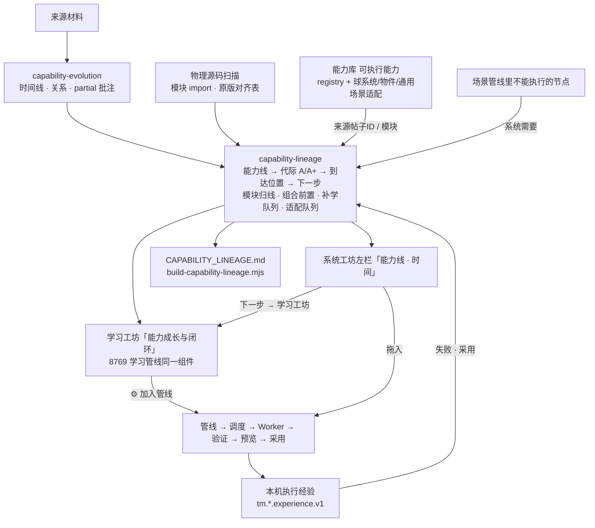

# PipeLineEngine、能力库与双工坊

2026-11-13。本系统的代码能力库是整个 `townscaper-web/REACodeRefactoring`。`src/capabilities/registry.js` 只是其中一组体素/显示执行适配，不能代表全部代码能力；旧游戏 vendor 副本也不是最新源库。

## 实际落点

- `src/pipeline-engine/PipeLineEngine.js`：组合预检、规范化参数、顺序调用、私有输入副本、执行与候选指纹、采纳门槛。
- `worker-adapters.js` / `worker-host.js`：四类改造 Worker 使用同一引擎；体素调用源库 registry/runPlan，物件和通用材质适配直接引用源库 path-samples / OKLab；球系统沿原有配方编译接口。
- `src/system-workshop/tier-agent.js`、`src/scene-authoring/agent/orchestrator.js`：新输入扫描、sceneId/层级检查、独立验证、真实预览成功标记、对照/放弃/采纳。跨场景或失效候选不能采纳。
- `tools/refactor/scan-code-library.mjs`：使用 esbuild 解析实际源码导出/依赖，不执行模块。读取原版290文件、当前coverage与历史范围证据，核对迁移候选和命名接口；字节或成员在读取中变化时拒绝此次扫描。
- `backend/code_library.py`、`/api/workshop/code-library`：固定仓库、固定只读扫描脚本；没有任意路径或代码输入。前端失败保留上次成功目录。
- `code-library-catalog.js`：实际源码节点与七组依赖组合。执行接口只按已有适配元数据关联，不把依赖图自动冒充可执行管线。
- `REACodeRefactoring/index.html`：能力库窗口、源码搜索、七组依赖图、三种当前View显示组合试用/恢复。View显示组合在主线程调用现有API，不是体素Worker重建。

## 学习与实现如何联动

学习记录继续提供原片、观察和剩余缺口；能力库目录改以物理源码为主。已有模块显示“已有代码”，不再因为缺少Worker包装被称为“原版占位”。历史视频卡仍用于追溯，和实际模块数量分开统计。

源码组合能找到已实现适配时，学习页可将“已适配部分”加入对应管线，例如 OKLab 色板归并→明暗层次。组合的其他模块仍需各自上下文和验证。通用材质目标写入通用场景管线的目标，不再错误修改莫西斯湖主配方。

扫描不执行未知源码，不自动新建任意函数调用器；算法名或文件名相近也不构成行为等价。当前10个未关联文件和已有落点的行为差距列在 `REACODE_LIBRARY_ALIGNMENT.md`。学习完成、代码存在、执行适配、运行验收分别记录。

## 已验证范围与边界

四类真实改造Worker及独立验证/预览生命周期此前有实测；此次增加实际源码扫描、双工坊目录、源库首页三组View试用、测量工具Worker与CLI。证据目录：`artifacts/code-library-rebuild-20261113`；引擎此前证据在 `artifacts/workshop-tests/pipeline-engine-20261113`。

引擎 catalogHash 是适配描述的签名，并非全部源文件内容的SHA。物理库扫描有独立源码SHA，尚未将所有依赖字节绑定到Worker执行回执。扫描不热替换正在运行的Worker。十二门徒多World适配、共享渲染扩展、各模块完整行为和跨GPU矩阵仍未全部验收。不得以新增目录或菜单声称两库已完全等价。

## 2026-11-14 作者时间线接入能力库

阶段顺序是本地学习导航，不声称作者只有这一条思考路线；next 正式名称未确认，2016 早期球面另列。时间较新的记录不自动升级执行权限。源码没有关联来源时日期为 null，不再把扫描当天当能力诞生日。当前 285 来源、28 主题、85 关系，177 partial 批注（高31/中119/低27）；原审核与现有 Worker 适配状态保持独立。详见 CAPABILITY_EVOLUTION.md。

## 2026-11-14 学习工坊 ⇄ 能力库闭环（能力谱系）

规划与规则见 `WORKSHOP_LOOP_PLAN.md`；每条能力线的代际、到达位置、补学队列见生成文件 `CAPABILITY_LINEAGE.md`。

落点：
- `REACodeRefactoring/src/core/capability-lineage.js`：纯计算，Node / 浏览器共用。`src/ui/capability-lineage.js/.css`：两页共用界面。
- `src/scene-authoring/learning-workshop.js`：默认页签 `lineage`；`studio.js` 提供 `getExecutables / getExperience / getDemand / onUseExecutable`。
- `src/system-workshop/capability-sidebar.js`：`能力线 · 时间`（默认）与 `工坊分区` 两种视图，事件 `tm.learning.lineage` 打开学习工坊对应能力线。
- `tools/refactor/build-capability-lineage.mjs`：生成文档；不含本机经验与管线需求。

边界：只做归类与排序，不改 done / partial，不新增可执行能力；PipeLineEngine、Worker、验证与采纳流程本轮未改。经验只读取、未统一回写；球系统 / 物件管线的待完成节点尚未进入需求。
