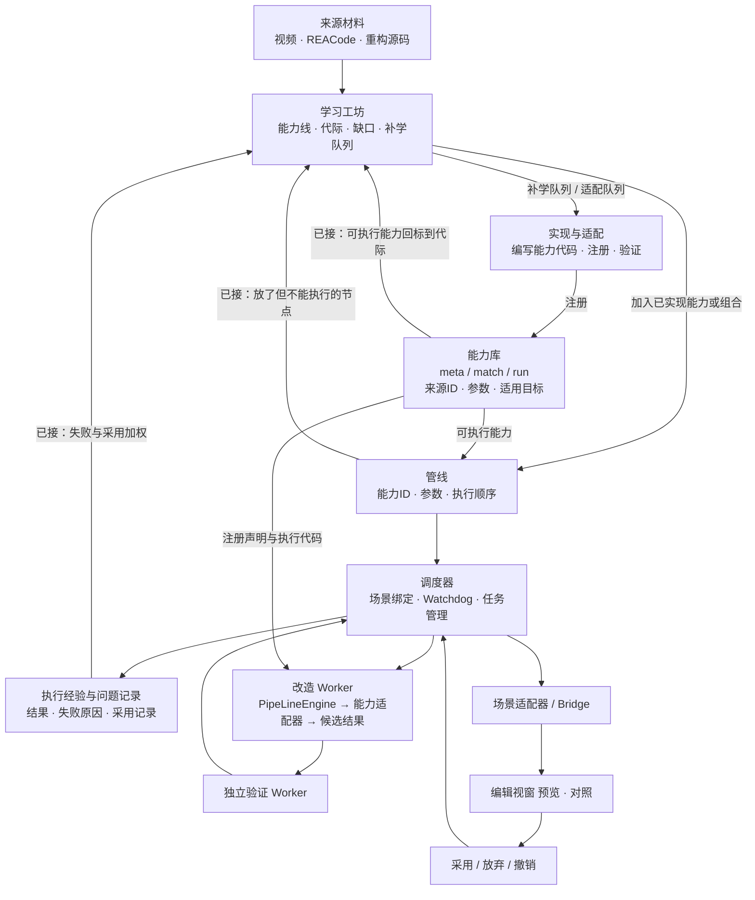

# 系统工坊 × 学习工坊：闭环规划

2026-11-14。接手任何「能力库 / 学习工坊 / 系统工坊」工作前先读本文件，再读生成文件 `CAPABILITY_LINEAGE.md`（每条能力线的代际、到达位置、补学队列）。架构落点见 `PIPELINE_ENGINE_ARCHITECTURE.md`，测试协议见 `WORKSHOP_GUIDE.md`。

## 1. 要解决的问题

用户的判断，逐条对照代码后成立：

| 用户指出 | 代码里的实际情况（本轮之前） |
|---|---|
| 能力库没有按时间理解能力的变化 | 学习工坊已有作者时间线（285 来源、28 主题、85 条关系），但系统工坊左栏仍按目录和文件名正则分区（`code-library-catalog.js` 的 `RULES`），列的是 `core/garden-paths.js` 这样的文件名，看不出哪个能力是哪个能力的下一版。 |
| 能力库缺组合概念 | 只有 7 组手写根文件的 import 闭包（`RECIPES`），是文件级依赖，不是「这项能力要先有哪项能力」。 |
| 系统需要的能力没有及时补 | 管线里可以放「待适配」节点，执行失败也记了经验（`tm.*.experience.v1`），但这两类信号没有回到学习工坊，补学顺序只有人工标的高 / 中 / 低。 |
| 重构停在中途，没有目标和方向 | 177 条 partial 各有批注，但没有「这条线代码到了哪一代、向前的下一步是哪一步、做完会解锁谁」。 |
| 8769 与 8931 两条学习管线对不上 | 两页共用时间线组件，但都停在「按时间排列的记录列表」，没有同一份「能力掌握到哪」的结论。 |

## 2. 目标架构

用户给出的架构图，逐条边对应到代码：



| 边 | 落点 | 状态 |
|---|---|---|
| 来源材料 → 学习工坊 | `REACodeRefactoring/learn/data.js`、`learn/pipeline.js.evolution` → `src/core/capability-evolution.js` | 已有 |
| 学习工坊内部：分类 · 来源映射 · 缺口 | `src/core/capability-lineage.js`（本轮新增）：能力线、代际、模块归线、原版文件归线、缺口 | **本轮接通** |
| 能力库 → 学习工坊 | 可执行能力的来源帖子 ID / 源码模块 → 对应代际升为「可执行」；`studio.js` 的 `getExecutables` | **本轮接通** |
| 执行经验 → 学习工坊 | `tm.capability.experience.v1` 与 `tm.<层>.experience.v1` → `getExperience` → 队列加权、代际标「执行并采用过」 | **本轮接通（读取）** |
| 管线 → 学习工坊（系统需要的能力） | 场景配方里没有执行适配的节点 → `getDemand` → 对应缺口 +8 分、列入「管线里等能力的节点」 | **本轮接通（场景管线）** |
| 学习工坊 → 管线 | 代际 / 组合里的 ⚙ 能力一键加入对应层管线（`onUseExecutable` → `dropInto`） | **本轮接通** |
| 系统工坊 → 学习工坊 | 左栏每条能力线的「下一步 → 学习工坊」（事件 `tm.learning.lineage`） | **本轮接通** |
| 学习工坊 → 实现与适配 → 能力库 | 补学队列与适配队列给出顺序；写代码、登记 `registry.js` 仍是人工 / 模型的开发工作 | 队列已有，实现未自动化 |
| 管线 → 调度 → Worker → 验证 → 预览 → 采用 | `PipeLineEngine.js`、`tier-agent.js`、`orchestrator.js`、`pipeline-bridge.js` | 已有，本轮未改 |
| 统一回写与补学队列持久化（图中虚线） | 经验仍分四个本机存储键，队列每次打开页面重算，不落盘 | **未做，见 §6** |

## 3. 计算规则

全部规则在 `townscaper-web/REACodeRefactoring/src/core/capability-lineage.js`，纯函数，Node 与浏览器同一份。输入都是已有事实；输出只做排序和归类，不改任何 done / partial 状态。

**能力线**：时间线里已梳理的主题（28 个里 27 个是能力线，1 个是展示 / 参考）。

**代际 A → A+ → A++**：一条线内的来源按发布时间排列，遇到下面任一情况开新一代：
- 有依据的关系指向它，类型是 扩展 / 改进 / 局部替代 / 跨场景适配 / 再次探索；
- 作者进入新阶段（Bad North → Townscaper → 后续实验 → 球面）后再次处理同一问题。

「同项机制说明 / 复用 / 方案分支」不开新一代，并入当前一代。参考与不适用的记录不上阶梯。

**层级**（每条来源、每一代取最高）：○ 已学习无代码 → ◐ 部分实现 → ● 代码完成 → ⚙ 有可执行能力 → ★ 执行并采用过。前三级取原库状态，后两级取能力注册与本机执行经验。

**到达位置与方向**：
- 代码到达 = 有完成代码的最新一代。
- 方向先向前：下一步是到达位置**之后**第一个有缺口的一代。A 已经有 A+ 时，不回头把 A 做满。
- 到达位置之后没有缺口了，才回补旧代；被后续方案「局部替代」的缺口不再排队。

**源码归线**：模块归给引用它最多的能力线（依据是学习记录里的代码位置）；没有来源记录的模块，按「谁 import 它」多数归线，标为推断。原版 REACode 文件按其重构落点和来源帖子归线。

**组合**：能力线 X 的模块 import 了能力线 Y 的模块（且反方向更少），或有「组合 / 复用 / 适配」关系，则 Y 是 X 的前置。一个文件 import 超过 10 个模块的装配入口不计入（它表示谁把大家装在一起，不表示先后）。前置按能力线的诞生时间排列。

**补学队列得分**：

```
得分 = 优先级（高30 / 中20 / 低10）
     + 本线向前的下一步 +6        − 已有更新一代完成代码的非高优先回补 −4
     + 是后续版本的前身 每条+3（≤9）
     + 被其他能力线当作前置 每条+2（≤10）
     + 本线已有可执行能力在用 +2
     + 管线已放入但不能执行 +8
     + 本线执行验证失败 每次+4（≤8）
```

同一来源属于多条线时只排一次。每一项都带排序理由，页面和文档都能看到。

**适配队列**：代码已完成、但能力库里没有任何可执行能力的能力线，按「管线在等 → 被依赖数 → 完成来源数」排序。这是「学习 → 实现与适配 → 能力库」那一段的待办。

## 4. 两条学习管线如何对应

| | 8769 `REACodeRefactoring/pipeline.html` | 8931 `TigerMessenger/pipeline.html#learning` |
|---|---|---|
| 计算 | 同一个 `capability-lineage.js` | 同一个 |
| 界面 | 同一个 `src/ui/capability-lineage.js` | 同一个（深色） |
| 时间线、代际、缺口、队列顺序基础分 | 相同 | 相同 |
| 可执行能力 | 只有能力库 `registry.js` 登记的 9 项 | 加上场景现有能力、球系统、物件、通用场景的执行适配 |
| 执行经验、管线需求 | 没有（说明里写明去系统工坊看） | 有，实时加权 |
| 原版 REACode 文件归线 | 没有 | 有（来自实时扫描的对齐表） |

差异只来自「系统这一侧多知道什么」。8931 比 8769 多的可执行能力，就是系统真正掌握、但源库页面看不到的部分。

## 5. 页面

- **学习工坊**新增默认页签「能力成长与闭环」：七个环节的闭环图（带实时数量，点击跳到对应段落）→ 能力成长图（27 条线 × 时间）→ 所选能力线的代际阶梯、方向、下一步缺口 → 组合前置 → 补学队列 → 适配队列与管线需求 → 执行经验。「来源与差距」跳到「时间线与能力演进」并定位到那条来源。
- **系统工坊左栏**能力库新增「能力线 · 时间」视图（默认）：能力线按诞生年份排列，每条线显示代际色块（到达位置有下划线、下一步有红框）、方向说明、可拖入管线的 ⚙ 能力、前置线，以及「下一步 → 学习工坊」。原来的分区列表保留为「工坊分区」，选择记在本机。能力集合两种视图都显示。
- **8769 学习管线**在时间线之上显示同一套「能力成长」。

## 5a. 界面原则（2026-11-15）

学习工坊首屏是「能力地图」，只回答三个问题：能力之间怎么连、每条线到了哪一代、选定的场景差在哪和先做什么。做法：一句话目标栏选场景和能力线；一张网；一个抽屉逐层展开。队列全表、闭环统计、执行经验在「队列与闭环」，其余资料在「更多资料」。首屏不加说明性长文字。

## 5b. 能力网与场景诊断（2026-11-15）

能力线不是并排的清单，是一张网：节点是能力线（节点里的色条是它的各代），边是前置。网上再叠一层「场景」：

- `tools/refactor/scan-scene-consumers.mjs` 静态读出游戏里每个场景实际 import 的能力库模块、来自旧 vendor 副本还是最新库、与最新库是否字节相同，写入 `src/scene-authoring/catalog/scene-consumers.json`。当前 7 组：莫西斯湖 237 模块（25 个旧副本）、战斗场 37（24）、十二门徒 18（17）、高山圣城 8（7）等。
- `capability-lineage.js` 把场景用到的模块对到能力线的每一代，给出四种状态：在用且与库一致 / 在用但是旧副本 / 库里有而场景没接 / 库里也没有代码。
- 引导按三步排：① 旧副本与库现行版本的差异（**同机位对照后再决定换不换**）→ ② 库里已有、场景没用的代际 → ③ 库里也没学到位的缺口（接到补学队列）。
- 人工做过的对照结论写在 `tools/refactor/scene-consumer-notes.json`，随诊断显示。

「差哪里、怎么补」因此有三个入口：整个能力库看补学队列，一条能力线看代际阶梯，一个场景看能力网上的诊断。第一个实例是十二门徒地形，见 `APOSTLES_TERRAIN_DIAGNOSIS.md`：静态诊断指出 17 个旧副本，实际对照却表明直接同步不是改进，真正的缺口在高度场和库里未学完的软坡。所以 ① 一律先对照，不默认「新的更好」。

## 6. 后续步骤（按顺序）

进度（2026-11-15）：第 3 步开了头，网格线有了第一项可执行能力 `grid.contours`（显示层，Node 用例通过，真实游戏里尚未验收）；适配队列剩 5 条线。第 1、2、5、7 步未动。新增一项：十二门徒地形按 `APOSTLES_TERRAIN_DIAGNOSIS.md` 的顺序补，起点是库里的地形 A+++（队列 #20）。


1. **经验统一回写**（图中虚线）。把四个经验存储键归一为带 `capabilityId / lineId / clipIds / 失败原因 / 候选指纹` 的记录，并能导出为文件；现在学习工坊只是读取。完成标志：一次验证失败后，不刷新页面，对应缺口的队列位置和理由随之变化，且导出文件可在另一台机器复算。
2. **补学队列落盘**。`build-capability-lineage.mjs` 已能生成文档；再提供「把本机经验与管线需求合并进去」的导出，使 8769 的学习自动任务可以直接读取同一份顺序。
3. **按适配队列封装**。当前 6 条线代码已有而不能执行：网格、界面装饰、战役、火焰、工具、水的消费者。网格被 4 条线依赖，先做。每封装一项：`registry.js` 登记 meta（含来源帖子 ID）/ match / run → 验证 Worker 用例 → 页面上该线出现 ⚙。
4. **按补学队列补缺口**。队首目前是：建筑 A+6（显式双格模块身份与统一撤销）、网格 A+4（四子格联合约束）、导航 A+（导航面接入战斗与自动生成）、模块约束 A+9（prefab / socket）、导航 A+4（球面与复杂汇流）。以 `CAPABILITY_LINEAGE.md` 当时的顺序为准。
5. **球系统 / 物件管线的需求回流**。现在只有场景管线里「放了但不能执行」的节点进入需求；另两层的待完成节点还没接。
6. **剩余归线**。90 个源码模块、40 个原版文件没有来源记录也没被已归线模块 import（清单在 `CAPABILITY_LINEAGE.md` 末尾），其中一部分是工具和页面，本就不属于能力线；其余需要补来源映射。
7. **把能力线写进执行回执**。Worker 回执里目前有计划与候选指纹，没有「这一步属于哪条能力线、哪一代」；加上之后经验才能精确回到代际而不是整条线。

## 7. 边界

- 代际是学习导航：按发布时间、阶段变化和已有依据的关系切分，不声称作者只有这一条思考路线。`next` 仍是本地对后续未命名实验的分组。
- 「代码到达」「可执行」来自原库状态和能力注册，本轮没有新增视频观看，也没有新增或验收任何能力代码；177 条 partial 仍是 partial。
- 模块的推断归线只用于归类，不代表该模块实现了这条能力线。
- 组合前置来自 import 方向和已有关系，不是可执行管线；每一步仍需各自的执行适配与独立验证。
- 执行经验存在浏览器本机，换浏览器或清存储后为空；`CAPABILITY_LINEAGE.md` 不含经验与管线需求。
- 上游学习任务持续改写 `learn/data.js`。来源记录变化后，对应批注显示「待复核」、按 15 分计入队列，直到重新评审。
