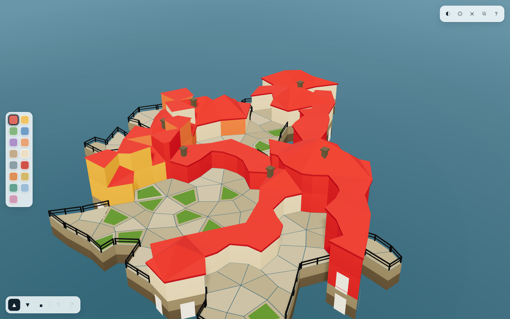
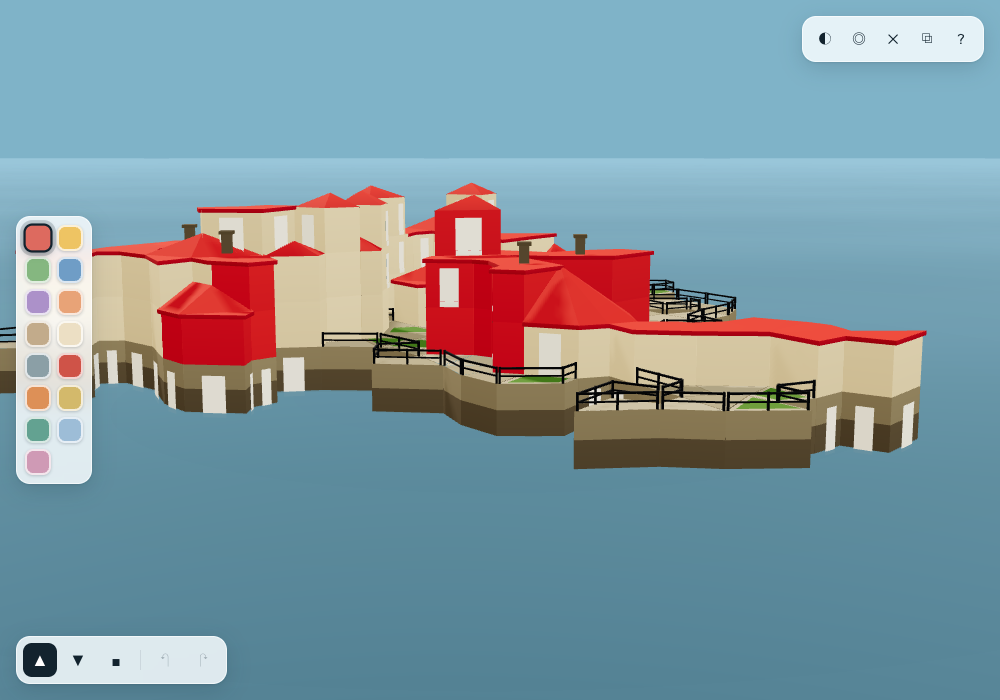
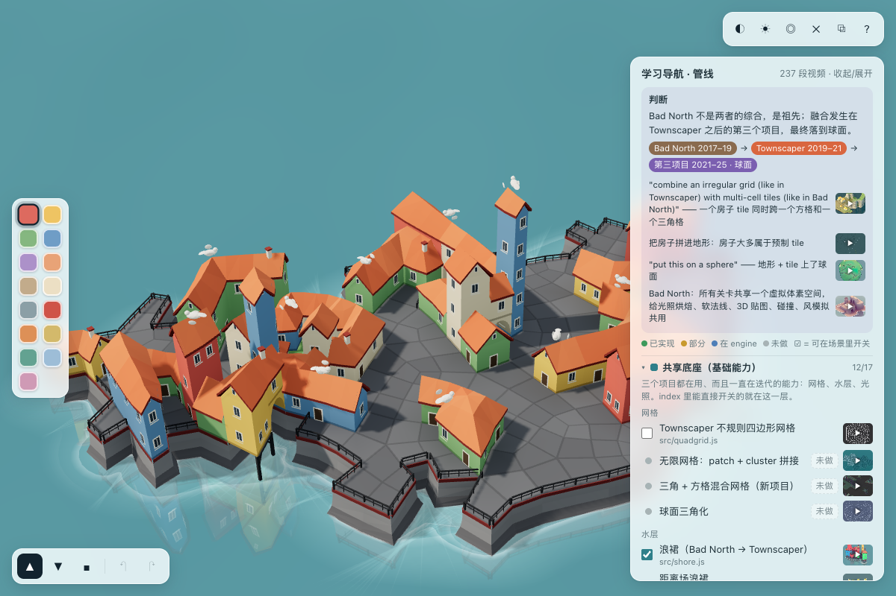

# Townscaper · REACode

对 `~/Downloads/TigerInBamboo/townscaper-web/Build` 里的 Unity WebGL 构建做逆向分析之后，用原生 Web（three.js）重写的 Townscaper 玩法实现。

不是把 Unity 的 wasm 反编译成可运行代码——23MB 的 IL2CPP wasm 剥符号之后做这件事不现实。这里的做法是：**用 REA 把游戏的结构和规则提取出来，再按这套结构重写一份可运行的实现**。







---

## 一、逆向过程与证据

`Build/` 是标准的 Unity WebGL 产物：

| 文件 | 大小 | 内容 |
|---|---|---|
| `WebGL.wasm` | 23 MB | IL2CPP 编译单元（已剥离符号） |
| `WebGL.data` | 31 MB | UnityWebData1.0 容器：`global-metadata.dat` + `data.unity3d` + `sharedassets*.resource` |
| `WebGL.framework.js` | 540 KB | Unity 运行时胶水 |
| `WebGL.loader.js` | 7.6 KB | 加载器 |

用 REA 做的三步：

1. **`rea analyze`** 对目录做初步鉴定 → 认出是 Unity WebGL 应用（对 31MB 的 data 做全量 JS 解析会 OOM，所以走下面两步定向分析）。
2. **解包 `WebGL.data`**（UnityWebData 头 + 偏移表）→ 取出 `Il2CppData/Metadata/global-metadata.dat`（4.4 MB）。
3. **`rea inspect-il2cpp-metadata`** 读 metadata → 34 个程序集、5414 个类型、37340 个方法、26587 个字段。

关键发现：游戏逻辑在 `Assembly-CSharp.dll`（677 个类型）里，**内部命名空间是 `Placemaker`**（Townscaper 的开发代号）。提取到的骨架：

| 原始类型 | 成员/方法（节选） | 反推出的职责 |
|---|---|---|
| `Placemaker.GridGenerator` | `HexToPlane` `PlaneToHex` `HexToPatchHex` `GetSubdivisions` `GetVertCost` `relaxationSteps` `MotivateBit` `IteratePatch` `GetQuad` `GetAdjecentQuad` | 六边形格 → 细分 → 共享顶点松弛，得到不规则四边形网格 |
| `Placemaker.Graphs.Graph` | `corners` `squares` `qubes` `edgeDict` `cornerFlowQueue` `boundsHeight` | 四边形拓扑图 + 体素图 |
| `Placemaker.Graphs.Qube` | `voxelCount` `cornerValues` `possibleModules` `sideVariationMask` `cost` | 每个立方体靠四角数值在模块表里选模块 |
| `Placemaker.ModuleBuilder` | `ApplyModule` `ApplyDecor` `MarkQubeForDeconstruction` | 模块装配 / 拆除 |
| `Placemaker.BigMeshMaster` + `BigMesh` | `verts` `normals` `tris` `availableTris` `AddMesh` | 所有模块顶点合进一个池，整城一次 draw call |
| `Placemaker.AoBaker` / `ShadowBaker` | `BakeAo` `GetShadowMesh` | 顶点烘焙 AO / 阴影 |
| `Placemaker.Voxel` | `type` `height` `cost` | 一个体素 = 类型 + 层高 |
| `Placemaker.VoxelType` | `Red` `Green` `Blue` `Yellow` `Color4`…`Color14` `Ground` `Any` `Water` `Empty` | **正好 15 个调色槽** |
| `Placemaker.TextSaveSystem` | `bitArray` `chars` `bitsPerCharacter` `SaveToString` `LoadFromString` | 存档 = 位数组 → 字符表编码 |
| `Placemaker.Maker` | `ActionQueueChanged` `BeginNewAction` `UndoCommand` `RedoCommand` `TrimActionList` | 撤销/重做命令栈 |
| `Placemaker.PropPlacer` / `Props.*` | `Window` `WindVane` `PropWire` `PropNgonScaler` | 窗户、风向标、电线等装饰件 |

这套骨架直接决定了本项目的文件划分（见下）。

---

## 二、怎么用

### 启动

**只想玩：双击 `Townscaper.html`** —— 单文件版本，three.js 和全部代码都内联在里面，不需要服务器、不需要联网。

**要改代码（模块化版）：双击 `启动.command`**，等价于在终端跑 `./start.sh`：

```bash
./start.sh                  # 默认 8765，起服务并打开浏览器
./start.sh --port 9000      # 换端口
./start.sh --no-open        # 只起服务，不开浏览器
./start.sh --stop           # 停掉（也可以双击「停止.command」）
```

脚本会做这几件事：端口被占用时自动往后找空闲端口（8766、8767…）、起服务后轮询到真的返回 200 才开浏览器、把 PID 写进 `.server.pid` 以便干净地停掉、日志落在 `.server.log`。已经在跑就直接复用，不会重复起。

> 模块化版本（`index.html` + `src/`）必须走 http，不能直接双击 `index.html`——ES module 在 `file://` 下会被浏览器按 CORS 拦掉。改完代码后重新打包 `Townscaper.html`：
> ```bash
> npx esbuild src/app.js --bundle --format=iife --minify \
>   --alias:three=./vendor/three.module.js --outfile=/tmp/bundle.js
> # 再把 /tmp/bundle.js 内联替换进 index.html 的 <script> 里
> ```

### 操作

| 操作 | 效果 |
|---|---|
| **左键拖动** | 建造：把光标下的地块升高一层，划过的地方连续升高 |
| **右键点击** | 拆除单块：只扣掉光标下的那一个体素，上面的方块留着并由木构托住 |
| **Shift + 左键** | 同样是拆除，适合用选择工具时临时删 |
| **点击色块 / `P` + 左键** | 刷色 |
| **右键拖动** | 旋转视角（和右键删除靠位移区分：<4px 算点击） |
| **中键拖动** / `Alt` + 左键 | 平移 |
| **滚轮** | 缩放 |
| `B` / `E` / `P` | 切换 建造 / 拆除 / 刷色 |
| `1`–`9` | 快速选色 |
| `Z` / `Y` | 撤销 / 重做（一次拖动 = 一步） |
| `R` | 重新生成示例城镇 |
| `C` | 清空 |
| `H` | 帮助面板 |

右上角：`◐` 换配色（3 套 15 色）、`◎` 生成示例城、`✕` 清空、`⧉` 复制分享链接、`?` 帮助。

### 存档与分享

每次编辑后地址栏会自动带上 `#<编码串>`，刷新、收藏、发给别人都能还原整座城。点 `⧉` 直接复制完整链接。

编码格式（对应 `TextSaveSystem` 的做法）：`[3b 版本][6b 网格半径]` + 游程记录 `[1b 是否空][4b 高度][5b 颜色][5b 游程-1][1b 继续]`，最后每 6 bit 映射到一个 64 字符表的符号。一座 560 格的小城约 1000 字符。

---

## 三、代码结构（与原文类型一一对应）

```
REACode/
├── Townscaper.html     单文件版（双击即玩，代码已内联压缩）
├── ENGINE.md           引擎说明：参考片原文 → 每条的实现
├── tools/              抽帧工具（无 ffmpeg 时用浏览器逐帧抓）
├── engine/             引擎：waves.js（岸边浪 + 动态海面）/ outline.js（描边）/ roofs.js（双坡顶）
│                     mesa.js（台地岛）/ terrain.js / islands.js
├── screenshot-terrain.png  quadrilateral-grid terrain
├── index.html          模块化版入口
├── start.sh            启动脚本（端口回退 / 健康检查 / PID 管理）
├── 启动.command         双击 = ./start.sh
├── 停止.command         双击 = ./start.sh --stop
├── screenshot.png      俯瞰
├── screenshot-close.png 低角度细节
├── vendor/three.module.js
└── src/
    ├── grid.js         Placemaker.GridGenerator   六边格 → 共享顶点松弛 → 四边形
    ├── town.js         Graphs.Graph / Qube        高度场、四邻关系、region 连通分量、调色板
    ├── mesh.js         ModuleBuilder + BigMesh + AoBaker   砌石墙、距离场屋顶、栏杆、浪花
    ├── scene.js        渲染、水面、相机、射线拾取
    ├── demo.js         示例城镇（播种随机）
    ├── save.js         TextSaveSystem            位数组 → 字符表
    └── app.js          Maker                     输入、撤销栈、UI、分享
```

### 实现要点

- **网格**：六边形晶格（轴向坐标）→ 每格拆成 6 个 kite 四边形 `(边中点, 角点, 边中点, 中心)`。角点和边中点在相邻六边形之间共享，对共享顶点做确定性抖动后再跑松弛（保证四边形仍然凸），得到的就是那种"每块大小都不一样"的不规则格。共 4326 格（半径 15）。
- **装配单位是"体量"不是"格子"**：同高的相邻格子连通成一个 region，一个 region 才是"一栋房子"——它拥有一个屋顶、一圈外墙、一圈栏杆。这是最关键的一条：按格子出屋顶会得到一片彩色帐篷地毯，按 region 装配才有房子。
- **屋顶**：对 region 的顶点做"到边界的最短距离"场，屋顶高度 = 距离 × 坡度（上限按体量面积自适应）。等距线自然形成屋脊——长条形出脊线、方形出攒尖，不用特判。檐口顶点沿外法线推出去做出檐，再沿檐口挂一圈 35mm 的檐板，屋顶才有厚度。
- **外墙**：水线一层是砌石基座（两皮 + 灰缝），往上按层数分带刷灰泥；每格一个 0.95±0.05 的色差做马赛克质感，但**同一 region 用同一个色号**——不是每格随机上色。
- **栏杆**：走道（level 1）临水的边上自动生成，立柱 + 双横杆，深色金属。
- **岸边浪花**：临水边界外扩一圈四边形，顶点 alpha 由内向外淡出（自定义 shader，`colorspace_fragment` 做色彩空间转换——漏了这步整个画面会发灰）。
- **几何**：所有面写进同一组 position/color 数组，非索引三角面 + `computeVertexNormals()` 得硬边法线，整城一个 mesh 一次 draw call（175 格城镇约 1.1 万三角形，重建约 4ms）。
- **拾取**：沿射线在 y∈[0, 9 层] 的薄板里步进 + 二分收敛；打不到柱体时回退到水面求交，所以点空海面也能造地。

---

## 四、体素与木构支撑

原版最有辨识度的机制是：**右键只扣掉一个方块**，上面的建筑不会塌，而是由自动生成的木构托住。要复刻它，数据模型不能是"每列一个高度值"。

- `town.solid` 是每格 9 bit 的位掩码，一个 bit 一层。所以可以在中间掏洞——这正是拱券和吊脚塔的来源。
- 渲染时墙按"暴露的连续层段"分段生成；底部方块的下表面会补一张暗色底面（soffit），不然会看穿。
- 底部悬空的柱子（`bottom() > 1`）自动长出支撑：网格角点上的方木立柱直落水面、离水 6cm 处套一圈白色浪脚、露出一边的边挂一根系梁和一根斜撑。立柱按**角点去重**（同一个角最多四个方块会各算一次），共享边只由编号小的一侧出撑，否则整座塔会变成木笼子。

存档格式升到 v3：每个游程从 4 bit 高度改成 9 bit 掩码，空洞能完整往返。

## 四、配色怎么对齐的

参考图的观感不是随手调出来的，是三个具体问题，逐个排掉：

1. **光照单位错了**：three r155 之后光照是物理单位（辐照度除 π），原来那套强度让整块画面只有色板的 **37%** 亮度——所以粉彩全变成了脏色。用 `readPixels` 采样比对（目标 `#8fbf8a` = 143,191,138，实测 54,102,49）定位，按测量值把四盏灯重新标定。
2. **色板本身不对**：原来的条目里有深藏蓝、墨绿，参考图里根本不出现。现在 15 槽全部按参考图取样，明度都压在 L\*55 以上（`PALETTES.town`）。
3. **墙和屋顶必须是两个色槽**：原版的红屋顶 + 奶白墙来自"只给顶部体素上色"。现在 `town.colors` 管墙、`town.roofColors` 管屋顶，点柱顶刷屋顶、点下面刷墙；存档格式升到 v2，每次 run 多带 5 bit。

渲染管线是 `NoToneMapping→ACESFilmic`（曝光 1.12）：ACES 压高光，奶白不会过曝，中间调仍贴着色板。

## 四、和原版的差距

对着官方截图逐项比过，仍然缺的：

| 项 | 原版 | 这里 |
|---|---|---|
| 拱、桥、楼梯、码头 | 手工建模的模块，两柱之间自动跨接 | **没有**，只有墙/屋顶/基座/栏杆 |
| 模块传播 | `cornerFlowQueue` + `possibleModules` 剪枝，屋顶沿街连续 | 简化成一次邻域判定 |
| 装饰件 | 窗、门、烟囱、水管、风向标、树上鸟群蝴蝶 | 只有窗、门、烟囱 |
| 屋顶细节 | 瓦片纹理、老虎窗、屋脊瓦 | 单色平面 + 檐板（色相与墙面分离） |
| 材质 | 手绘贴图 + 烘焙 AO/阴影贴图 | 纯顶点色 + 实时阴影 |
| 网格 | 无限延展的岛 | 固定半径 15 |
| 音效 | 有 | 没有 |

已经对齐的：不规则格、按体量装配、四坡顶脊线、砌石基座、白框窗、临水栏杆、岸边浪花、按 region 上色、位数组存档、撤销/重做命令栈。

要继续做，顺序建议：拱/桥模块（两柱跨接）→ 模块传播队列（屋顶沿街连续）→ 装饰件（水管、树）→ 瓦片贴图。
